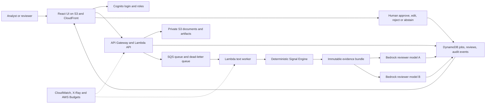

# Portfolio Product V1 Architecture

Status: planned reference architecture; no AWS resources exist yet.

## Logical Flow

## Initial AWS Choices

- Static React/Vite UI in private S3 behind CloudFront.
- Cognito user pool and groups for analyst, reviewer, and admin roles.
- API Gateway HTTP API with JWT authorisation.
- Lambda for the API and bounded text-processing worker.
- SQS plus a dead-letter queue for durable asynchronous processing.
- DynamoDB for job, review, idempotency, and audit metadata.
- Private S3 buckets for uploads, evidence bundles, and approved reports.
- Secrets Manager for provider or integration secrets; no keys in code or CI.
- Bedrock Converse API for fixed-bundle model comparisons.
- CloudWatch structured logs/metrics, X-Ray traces, and AWS Budgets alerts.
- Python AWS CDK with cdk-nag for infrastructure as code and policy checks.

No VPC, NAT Gateway, RDS, OpenSearch, always-on containers, or provisioned model
capacity is planned for v1. A container worker is an escape hatch only if a
measured text workload exceeds Lambda limits.

## Trust Boundaries

1. Public browser to CloudFront and Cognito.
2. Authenticated browser to API Gateway.
3. API identity to private job/document resources.
4. Worker to deterministic core and approved Bedrock model IDs.
5. Reviewer decision to approved output and evaluation stores.
6. CI identity to deployment role through short-lived GitHub OIDC credentials.

Every boundary requires least privilege, explicit resource ownership, and an
auditable request/job identifier.

## Canonical Truth

The deterministic output and its source evidence are immutable inputs to model
review. Model outputs are separate candidate reviews. Human decisions are
separate audited records. No layer silently overwrites another.

## Rollback

- Deploy versioned immutable UI assets.
- Keep the previous Lambda version/alias available during rollout.
- Make infrastructure changes through reviewed CDK diffs.
- Retain compatible job/evidence schemas or provide an explicit migration.
- Disable model invocation without breaking deterministic local/core behavior.
